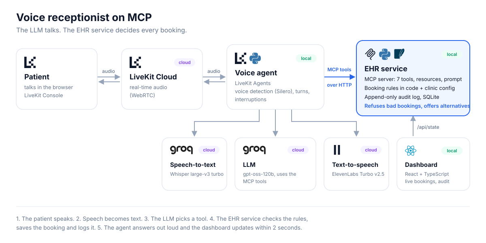

# Voice receptionist on MCP

A small AI receptionist that patients can talk to by voice. It books, moves and cancels appointments in a
fake medical records system (EHR) that is exposed as an **MCP server**.

The idea behind it: **the LLM handles the conversation, but it never decides whether a booking is allowed.**
Every rule ("Dr. Johnson only sees patients on Fridays at 2 p.m. at Office A") is checked by tested code on
the server. When a rule says no, the server explains why and returns valid alternatives, so the conversation
can continue.

> Learning project. All data is synthetic.

## How it works



1. The caller speaks. The **voice agent** (LiveKit Agents) detects the end of the sentence and turns it into text.
2. The **LLM** decides what to say and which tool to call, for example `book_appointment`.
3. The **EHR service** checks the rules, saves the booking and writes an audit log entry, even when it refuses.
4. The agent speaks the answer. The **dashboard** shows the new appointment and the audit log within 2 seconds.

**MCP tools:** `find_patient`, `search_slots`, `book_appointment`, `reschedule_appointment`,
`cancel_appointment`, `verify_insurance` (simulated), `escalate_to_human`.
**Resources:** `practice://directory`, `practice://rules`, `audit://recent`, `audit://appointments/{id}`.
**Prompt:** `receptionist_call`.

## Run it

You need Python 3.11, Node 22, a [Groq](https://console.groq.com) API key and a free
[LiveKit Cloud](https://cloud.livekit.io) project.

**1. Install**
```powershell
py -3.11 -m venv .venv
.\.venv\Scripts\activate
pip install -e ".[dev]"
cd dashboard; npm install; npm run build; cd ..
```

**2. Create a `.env` file**

| Variable | Value |
|---|---|
| `LLM_BASE_URL` | `https://api.groq.com/openai/v1` |
| `LLM_API_KEY` | your Groq key |
| `LLM_MODEL` | `qwen/qwen3.8-27b` |
| `LIVEKIT_URL`, `LIVEKIT_API_KEY`, `LIVEKIT_API_SECRET` | from LiveKit Cloud, Settings → API keys |
| `TTS_PROVIDER` | `groq` (Orpheus voice) or `elevenlabs` (then also `ELEVEN_API_KEY`) |

**3. Start it (two terminals)**
```powershell
python -m ehr_server.server --http                   # EHR service + dashboard on http://localhost:8000
python -m agent.voice_agent dev --log-level warn     # voice agent, connected to LiveKit Cloud
```

**4. Talk to it:** open the **Console** in LiveKit Cloud and press **Start a session**. Use headphones.
Try: *"Hi, I'm James Carter, born November 2nd 1972. I'd like to see Dr. Johnson next Tuesday."*
Dr. Johnson only works Fridays, so the server refuses and the agent offers the next Friday at 2 p.m.

**Other ways to run it**

| Command | What it does |
|---|---|
| `python -m agent.voice_agent console` | Talk from the terminal with the laptop mic (no LiveKit Cloud needed) |
| `python -m agent.text_agent` | Chat by text; tool calls and timings are printed |
| `pytest` | 57 tests: rules, operations, audit log, MCP protocol, agent loop with a fake LLM |
| `python -m ehr_server.db` | Rebuild the database with the synthetic data |
| `docker compose up --build` | Run the EHR service and the voice agent as two containers |

GitHub Actions runs the tests on every push.

## Synthetic patients

| Name | Date of birth | Useful for |
|---|---|---|
| James Carter | 1972-11-02 | Holds Dr. Johnson's slot this Friday |
| Maria Lopez | 1985-03-14 | Has an upcoming visit to reschedule or cancel |
| Lily Chen | 2015-06-21 | Child: only the pediatrician |
| Robert Smith | 1990-01-30 | Insurance inactive: cannot book, gets escalated |
| Aisha Khan | 1999-08-09 | New patient, Cigna: some doctors refuse her |
| John Miller | 1980-04-04 and 1955-09-19 | Two patients with the same name |

## Project layout

| Path | What is inside |
|---|---|
| `ehr_server/server.py` | The MCP server: tools, resources, prompt, plus `/api/state` for the dashboard |
| `ehr_server/ehr.py` | The operations behind the tools (search, book, reschedule...), each one audited |
| `ehr_server/rules.py` | Config models, error codes and the rule checks (pure functions) |
| `ehr_server/db.py` | SQLite schema, synthetic seed data, append-only audit log |
| `ehr_server/practice_rules.yaml` | The clinic's rules: who works when and where, insurance, age limits |
| `agent/` | `voice_agent.py` (LiveKit), `text_agent.py` (terminal), `core.py` (shared LLM + MCP loop) |
| `dashboard/` | React + TypeScript page that polls `/api/state` |

## Limitations

- **Not production-ready:** no phone line, no real EHR, simulated insurance checks, identity is only name + date of birth.
- **Synthetic data only.** Real patient data would need HIPAA agreements (BAAs) with every vendor (LLM, speech,
  LiveKit), encryption and access control for the database and audit log, and consent for recording calls.
- **Latency:** in informal tests, about 2 to 4 seconds per turn, mostly waiting for the end of speech and for the LLM.
- **Hardware:** on an 8 GB laptop the voice agent runs better outside Docker; in production it would run on a
  server with dedicated CPU.
- One practice, one time zone, SQLite. Production would use PostgreSQL and per-customer configs.
